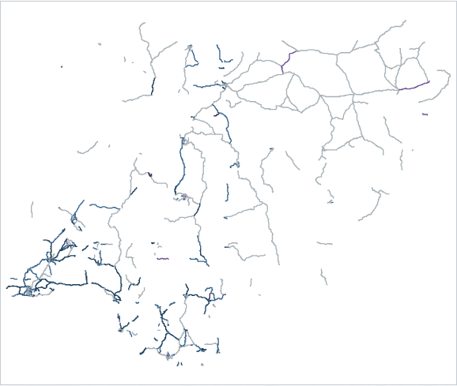
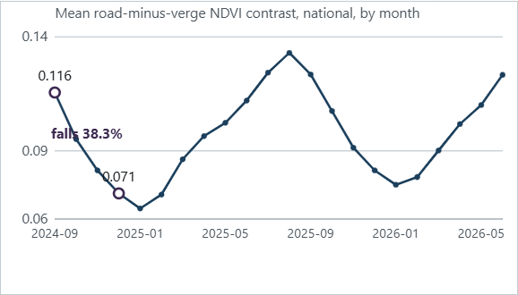
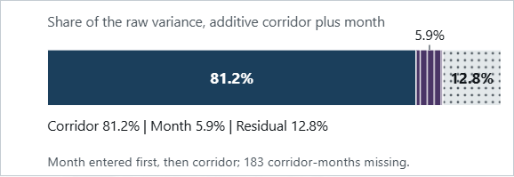
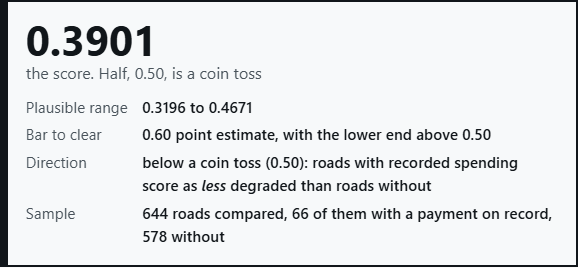

# RoadSense Nigeria

A reproducible, zero-cost measurement of satellite-observed change on Nigeria's 850 named federal
highway corridors — and the pre-registered test that failed when the measurement was checked against
the open record of where maintenance money went.


<p align="center">
  <a href="https://batestguy.github.io/roadsense-nigeria/publish/">Report</a> ·
  <a href="https://doi.org/10.5281/zenodo.24081356">Paper</a> ·
  <a href="https://huggingface.co/datasets/JBZABC/roadsense-nigeria">Dataset</a> ·
  <a href="docs/article.md">Article</a> ·
  <a href="docs/findings.md">Findings register</a>
</p>

---

## The question, and the answer

**Question.** Nigeria allocates money to federal roads every year and records it in an open
procurement register. Satellites photograph the country every month, free. Can the second tell you
which roads are deteriorating — and does that agree with where the money went?

**Answer.** No. The measurement was built, completed and tested against a bar that was written down
before the test ran. It failed, and it failed in the direction that matters: corridors with a recorded
payment scored as **less** degraded than matched corridors without one. The whole interval sits below
0.50, so this is not a weak signal. The ranking is inverted.

**What that means.** Not that satellites cannot see roads — a 2026 peer-reviewed study classifies road
roughness from the same free imagery at national scale. What failed here is the **label**: a procurement
record is evidence that money moved, not that a road was in poor condition. Validating a condition
measure against a spending record asks two different questions and calls them one.

### The result

| Instrument | Score | 95% interval | What it is |
|---|---:|---|---|
| **Primary — year-on-year change** (pre-specified) | **0.3901** | 0.3196 – 0.4671 | Is this road moving unusually badly against its own history? |
| Secondary — trend slope, ≥ 15 months | 0.4318 | 0.3544 – 0.5137 | Least-squares slope per corridor |
| Reference — raw unadjusted appearance | 0.3133 | 0.2461 – 0.3881 | How the road looks, no correction |

Bar, fixed before the run: **0.60**, with the lower bound above 0.50, and the direction fixed as
"corridors with recorded spending score as more degraded". Sample: 644 corridors — 66 with a payment on
record, 578 matched on road class and length. A hundred label permutations put the observed value
(0.3901) outside the null, whose minimum was 0.4145: the association is real, and it runs the wrong way.

### The mistake the project caught in itself

The first version of the score averaged a value that had already been centred on each corridor's own
months. That average is zero by construction — for a balanced panel exactly zero, and for this panel
exactly whatever the missing months made it. 726 of 850 corridors received one identical value.
It produced a plausible-looking 0.5735 that was ranking **data coverage**, not condition (correlation
0.94). A gate now refuses to compute a score before checking that it varies, and it runs before the
test rather than after it.

That broken value sat *above* 0.50, on the side the hypothesis predicted. Fixing the arithmetic moved
the result to 0.3901, below 0.50. The one change ever made to this analysis moved the result **against**
the hypothesis.

---

## What the five figures show

| The map: where the gap between road and verge moved | The seasonal trap |
|---|---|
|  |  |

| Where the variation sits | The score, and its bar |
|---|---|
|  |  |

All five figures are generated by `scripts/build_report.py` from the published tables. None is drawn by
hand, and the build fails if a number appears on the page that no source explains.

---

## The data

Published openly — no login, no token, about 6 MB in total:

| Table | Rows | What it is |
|---|---:|---|
| `condition.parquet` | 18,700 | One row per corridor-month: the road-to-verge gap, season removed, plus its components |
| `imagery_r10.parquet` | 69,212 | One row per corridor × tile × month, at 10 m |
| `weather.parquet` | 18,700 | Monthly rainfall and temperature per corridor |
| `weather_daily_features.parquet` | 18,700 | Rolling 30-day totals, maximum 7-day totals, dry-day counts |
| `corridors.csv` | 850 | Geometry join keys, class, length, and the procurement label |

Every table ships with a manifest naming the runs that produced it. Missing values are counted and left
missing: 183 corridor-months have no usable reading, and 378 contrast values (0.55%) are blank.

**Who this is useful to.** Anyone who holds a *physical* condition label — roughness readings, pavement
ratings, an agency inventory. This is the cheap half of a validation study, done for a country where
almost nobody has done the cheap half. Join a real condition label to it and the test we could not run
becomes possible.

---

## Statistical methods and models used

No machine-learning model was fitted. That is a decision, not an omission: a hazard model was planned,
and was abandoned when the measurement failed to validate against the only label available. Building a
model on an unvalidated measure would have produced a number nobody could defend.

What was used instead:

| Method | Where | Why |
|---|---|---|
| **Rank statistic (AUC)** | Primary, secondary and reference comparisons | Non-parametric, no distributional assumption, and it answers the question a budget asks: *given two roads, which does this measure pick?* |
| **Bootstrap intervals**, 2,000 resamples, stratified by label | Every estimate | Corridors, not readings, are the unit, so resampling was done on corridors |
| **Permutation test**, 100 label shuffles | Sanity check on the primary | Distinguishes "no effect" from "an effect in the wrong direction" |
| **Two-way additive decomposition** (corridor + month effects) | Feature construction | Removes land cover and season, which the variance split shows account for 81.2% and 5.9% of the raw spread |
| **Sequential variance decomposition** | The variance figure | Order-dependent, and the order is stated wherever it is quoted |
| **Per-corridor least-squares slope** | Secondary instrument | A second opinion that needs no calendar-matching |
| **Exact + quintile matching** | Sample construction | 66 labelled corridors paired with 578 unlabelled ones of the same class and similar length |

The gate that guards all of this is a **degeneracy check**: distinct values, modal share, standard
deviation, and correlation with data coverage — computed before any score is ranked.

---

## Work done

| Area | What exists | Where |
|---|---|---|
| Network | 850 named federal corridors, 18,419 km, geometry at 11 m tolerance | `scripts/build_corridors.py`, `build_geometry.py` |
| Imagery | 22 months at 10 m, 11 collection windows, ~70 GB streamed on free CI, nothing stored | `scripts/backfill.py`, `.github/workflows/backfill.yml` |
| Weather | Monthly and daily features for all 18,700 corridor-months, no gaps | `build_weather.py`, `build_weather_daily.py` |
| Labels | 2,036 procurement entries → 1,672 matched attempts → 181 high-confidence → 66 corridors; ceiling ~200 | `src/roadsense/gate0.py`, `docs/label-matching-report.md` |
| Measurement | Road-to-verge gap, 18,700 corridor-months, corridor and month effects removed | `build_condition.py` |
| Validation | Pre-registered, gated, and failed | `validate_signal_v2.py`, `docs/findings.md` F23 |
| Publication | Report page regenerated from data, dataset, nine-page paper | `docs/publish/`, `publish_dataset.py`, `docs/paper.md` |
| Tests | 91 tests on Python 3.12 and 3.13, with guards proven to fail when bypassed | `tests/`, `.github/workflows/ci.yml` |

The full chronological record, including the dead ends, is in [`docs/findings.md`](docs/findings.md) —
24 numbered findings, each with the date it was taken and what it overturned.

---

## Toolchain

**Code and data.** Python 3.12 / 3.13 · pandas · NumPy · PyArrow · DuckDB (views over the published
parquet) · rasterio, shapely, pyproj for geometry · pytest · ruff.

**Imagery and weather.** Sentinel-2 L2A through a public STAC catalogue and anonymous COG range reads ·
Open-Meteo archive (ERA5-based) · per-window manifests so every row traces to the run that made it.

**Delivery.** GitHub Actions (sharded collection, CI on two Python versions) · GitHub Pages · Hugging
Face Datasets · Zenodo for the paper's DOI · pandoc + XeLaTeX for the PDF · Playwright for checking the
rendered page at 375 px and 1440 px.

**Discipline.** Every number on the page is emitted by the generator and re-checked against its source
file on each build; a figure typed by hand fails the build. Claims that could not be verified were
removed rather than softened, and the ones that stayed are dated.

---

## Reproduce it

```bash
python -m pip install -e ".[dev]"     # pandas, numpy, pyarrow, duckdb, pytest, ruff
python -m pytest tests -q             # 91 tests, no network
python -m ruff check src tests scripts

python scripts/run_gate0.py           # Gate G0: one download, then label matching
python scripts/build_corridors.py     # -> data/interim/corridors.csv (850 rows)
python scripts/build_geometry.py      # -> data/interim/corridors.geojson
python scripts/build_condition.py     # -> the corridor-month panel
python scripts/validate_signal_v2.py  # the pre-registered test and its gate
python scripts/build_report.py        # -> docs/publish/index.html, with the number audit
```

Collection, which is the expensive part, is documented in
[`docs/handoff.md`](docs/handoff.md) and runs from the sharded workflow:

```bash
gh workflow run backfill.yml -f resolution=10 -f shards=96
```

---

## Repository layout

```
src/roadsense/     importable package: text matching, states, geometry, STAC sampler, corridors, warehouse
scripts/           thin CLI entry points, one per job
tests/             91 tests, synthetic frames only, no network
docs/              findings, handoff, phases, article, paper, generated report page and its images
data/              gitignored; raw downloads and derived tables
dist/              gitignored; dataset build output for upload
.agent/            ticket briefs, progress logs and reports — gitignored
```

---

## What this does not claim

- **Not a pavement rating.** It measures reflectance, not roughness, cracking or structural condition.
- **Not a causal statement about maintenance.** 66 labelled corridors, an observational comparison, no
  trial. A procurement record is evidence that money was allocated, never that a road failed.
- **Not a national ranking.** The score has no level: a corridor that has always been poor and one that
  has always been good look the same. It measures movement against a road's own history.
- **Not commercial.** The rainfall reanalysis is licensed for non-commercial use; the code is MIT and
  the derived tables are CC BY-SA 4.0.

---

## Cost

Zero, recurring. No paid dependency, no metered API, no card on file. The imagery is free and open, the
collection runs on public CI runners, the dataset and the paper live on free tiers.

<!--
VIDEO — when the walkthrough is recorded, put it here and delete this comment:

## Two-minute walkthrough

[](https://youtu.be/XXXXXXXXX)

What the page shows, why the test failed, and what the data can be used for.
-->
